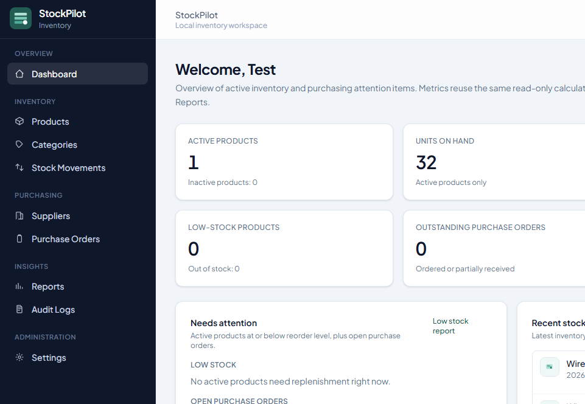
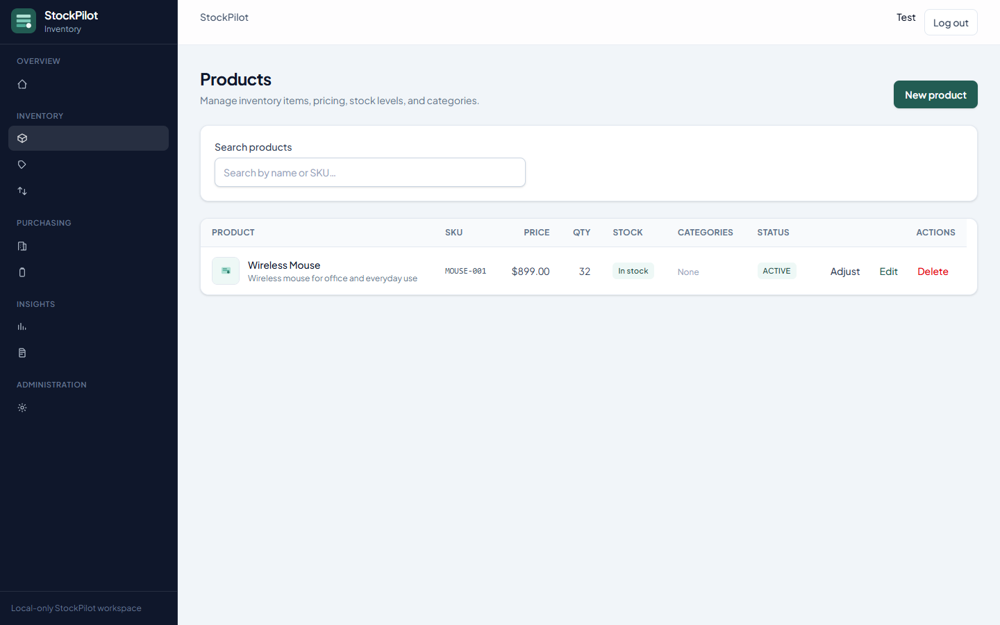
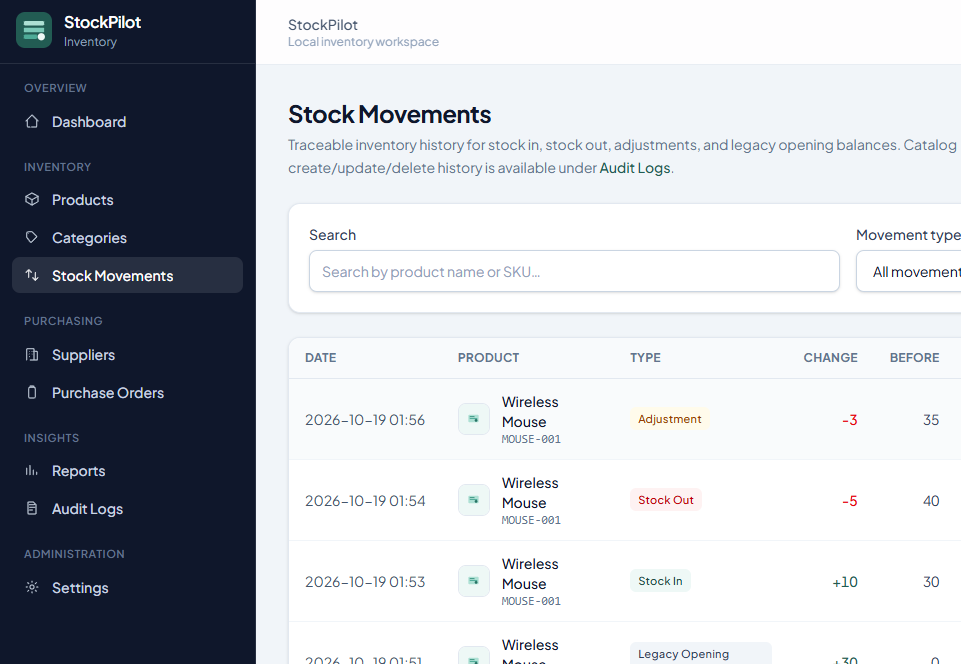
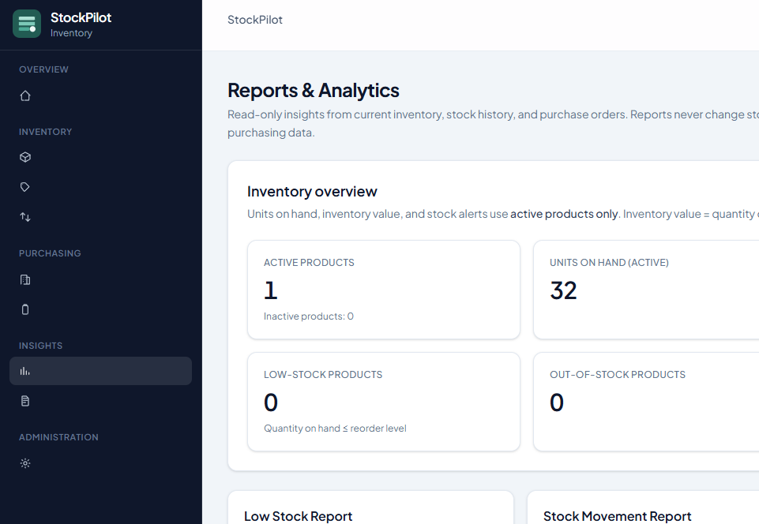
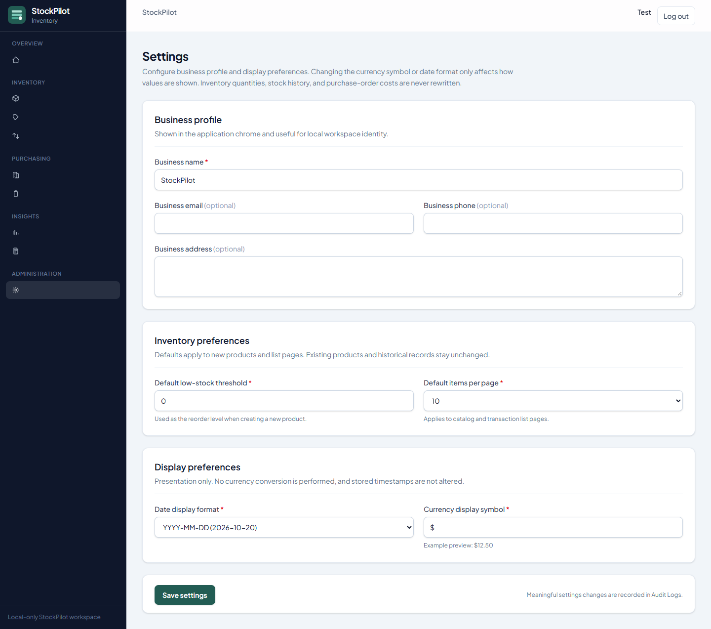

# StockPilot

StockPilot is a local inventory management application for tracking products, stock movements, suppliers, and purchase orders. It is built with Laravel 12, Livewire 4, PostgreSQL, and Vite, and is intended for local development and portfolio demonstration rather than multi-tenant production hosting.

A concise operator guide is available in [docs/USER_GUIDE.md](docs/USER_GUIDE.md).

## Overview

StockPilot keeps on-hand quantity aligned with an explicit movement ledger. Catalog changes, purchasing actions, and settings updates are audited. Product images are stored on the local public disk. Reports provide inventory and purchasing visibility with CSV export.

Typical use cases:

- Maintain a product catalog with categories, prices, reorder levels, and optional images
- Apply Stock In, Stock Out, and signed adjustments without directly editing stored quantities after create
- Manage suppliers and purchase orders with partial receiving
- Review audit history and export operational reports

## Key features

| Area | Capabilities |
| --- | --- |
| Authentication | Register, login, logout, password reset (mailer defaults to log in local setup) |
| Catalog | Products, categories, SKUs, cost/unit price, reorder level, active flag |
| Product images | JPEG / PNG / WebP upload, replace, remove; placeholders when missing |
| Inventory | Stock In, Stock Out, signed adjustments, opening stock on create, movement history |
| Purchasing | Suppliers, draft-to-received purchase orders, partial receipts, cancellation rules |
| Reports | Dashboard metrics, low stock, stock movements, purchasing; CSV export |
| Settings | Business profile, default reorder level, pagination, date format, currency symbol |
| Audit | Create / update / delete snapshots for catalog, purchasing, and settings |

## Technology stack

| Layer | Choice |
| --- | --- |
| Backend | PHP (Composer requires `^8.2`), Laravel 12 |
| UI | Livewire 4, Blade, Tailwind CSS 4 |
| Frontend tooling | Vite 6, npm |
| Database | PostgreSQL for local application use; PHPUnit uses SQLite in-memory |
| Testing | PHPUnit 11 |
| Storage | Laravel `public` disk for product images |

## Application screenshots

Real captures from a local StockPilot session populated with the original Wireless Mouse record plus 100 `DEMO-` catalog products. Purchasing modules remain empty. Session email and internal IDs were masked before capture where needed. Full gallery notes: [docs/screenshots/README.md](docs/screenshots/README.md).

### Dashboard



### Products



### Stock movements



### Reports



### Settings



### More screenshots

| Screen | File |
| --- | --- |
| Product editor | [`product-editor.png`](docs/screenshots/product-editor.png) |
| Categories | [`categories.png`](docs/screenshots/categories.png) |
| Suppliers (empty) | [`suppliers.png`](docs/screenshots/suppliers.png) |
| Purchase orders (empty) | [`purchase-orders.png`](docs/screenshots/purchase-orders.png) |
| Low stock report | [`low-stock-report.png`](docs/screenshots/low-stock-report.png) |
| Stock movement report | [`stock-movement-report.png`](docs/screenshots/stock-movement-report.png) |
| Purchasing report | [`purchasing-report.png`](docs/screenshots/purchasing-report.png) |
| Audit logs | [`audit-logs.png`](docs/screenshots/audit-logs.png) |

Purchase order detail was not captured: no existing order was available, and demo orders were not created for documentation.

## Requirements

- PHP 8.2 or later with common Laravel extensions (including `pdo_pgsql` when using PostgreSQL, plus image support such as GD or Imagick for upload validation)
- Composer 2
- Node.js 18+ and npm (Vite 6)
- PostgreSQL 14+ recommended for application data
- Git

Automated tests do not require PostgreSQL; they use SQLite `:memory:` as configured in `phpunit.xml`.

## Local installation

Portable commands are shown first. PowerShell notes are included where Windows paths or quoting differ.

### 1. Clone the repository

```bash
git clone https://github.com/devtdlv/stockpilot.git
cd stockpilot
```

### 2. Install PHP dependencies

```bash
composer install
```

### 3. Install Node dependencies

```bash
npm install
```

### 4. Create the environment file

```bash
cp .env.example .env
```

PowerShell:

```powershell
Copy-Item .env.example .env
```

### 5. Generate the application key

```bash
php artisan key:generate
```

### 6. Configure PostgreSQL

See [PostgreSQL database configuration](#postgresql-database-configuration).

### 7. Run migrations

```bash
php artisan migrate
```

### 8. Link public storage (required for product images)

```bash
php artisan storage:link
```

On Windows this typically creates a directory junction from `public/storage` to `storage/app/public`.

### 9. Build frontend assets

For a one-off production-style build:

```bash
npm run build
```

Or run Vite in watch mode during UI work:

```bash
npm run dev
```

### 10. Start the application

```bash
php artisan serve
```

Optional Composer script (server, queue listener, logs, and Vite together):

```bash
composer run dev
```

Open `http://127.0.0.1:8000` (or the URL shown by `artisan serve`). Registration is enabled: create an account from **Register**, then use the authenticated areas of the app.

## PostgreSQL database configuration

`.env.example` ships with Laravel’s default `sqlite` connection for skeleton compatibility. For StockPilot’s intended local database, set PostgreSQL values in `.env`:

```env
DB_CONNECTION=pgsql
DB_HOST=127.0.0.1
DB_PORT=5432
DB_DATABASE=stockpilot
DB_USERNAME=your_username
DB_PASSWORD=your_password
```

Create the empty database in PostgreSQL before migrating. Do not commit real passwords or personal `.env` values.

Example using `psql` (adjust role names to your install):

```bash
createdb stockpilot
```

Then:

```bash
php artisan migrate
```

## Running the application

| Task | Command |
| --- | --- |
| HTTP server | `php artisan serve` |
| Vite HMR | `npm run dev` |
| Asset build | `npm run build` |
| Migrations | `php artisan migrate` |
| Storage link | `php artisan storage:link` |
| Combined local stack | `composer run dev` |
| Preview demo catalog | `php artisan stockpilot:demo-products --dry-run` |
| Seed demo catalog (local only) | `php artisan stockpilot:demo-products` |

Root URL `/` redirects to `/dashboard`, which requires authentication. See [Optional sample inventory (demo products)](#optional-sample-inventory-demo-products) before seeding.

## Product image storage setup

1. Ensure `php artisan storage:link` has been run.
2. Product images are stored on the `public` disk under `products/{uuid}.{jpg|png|webp}`.
3. The database stores only the relative `image_path` string (nullable). Binary image data is never stored in PostgreSQL.
4. Browser URLs resolve as `/storage/products/...` through the public storage link.
5. Uploads accept JPEG, PNG, and WebP up to 2 MB. Invalid, spoofed, oversized, and SVG uploads are rejected.
6. Replacing or removing an image updates the path and deletes the previous managed file when safe. Deleting a product removes its managed image file.

## Core inventory workflows

### Products and categories

- Create and edit products with SKU uniqueness, pricing, reorder level, and optional multi-category assignment.
- Opening quantity may be set on create only. It is recorded as a stock movement when greater than zero.
- Subsequent quantity changes go through stock services, not arbitrary product field edits.

### Product images

Upload, replace, or remove images from the product editor. Listings and related screens show thumbnails or a placeholder.

### Stock operations

| Operation | Behavior |
| --- | --- |
| Stock In | Increases on-hand by a positive quantity |
| Stock Out | Decreases on-hand; blocked if result would be negative |
| Adjustment | Signed non-zero delta for corrections |
| Opening stock | Recorded on product create when quantity &gt; 0 |

Each movement persists `quantity_before`, `quantity_change`, `quantity_after`, type, reason, product, and user inside a database transaction with row locking.

### Audit history

Catalog, supplier, purchase-order, and settings mutations write audit log snapshots (before/after). Image audits record path strings only. Stock quantity changes are visible in the stock movement ledger.

## Purchase order and receiving workflow

1. Create a **Draft** purchase order against a supplier with line items (product, ordered quantity, unit cost).
2. Mark the order **Ordered**.
3. Receive quantities against ordered or partially received orders. Partial receipts are supported.
4. Status becomes **Partially Received** or **Received** as lines complete.
5. Draft or ordered (unreceived) orders may be cancelled according to application rules.

Receiving posts stock-in movements and records receipt lines. Each receipt carries an idempotency key so retrying the same receive action does not double-apply inventory.

## Reports and CSV exports

| Report | Purpose |
| --- | --- |
| Dashboard / inventory overview | Active products, units on hand, inventory value at cost, low-stock and out-of-stock counts, outstanding POs |
| Low stock | Products where on-hand ≤ reorder level; suggested replenishment is the gap to reorder level |
| Stock movements | Filterable movement history including opening balances |
| Purchasing | Purchase-order and supplier purchasing summaries |

CSV downloads stream UTF-8 with a BOM and escape cells that could be interpreted as spreadsheet formulas (`=`, `+`, `-`, `@`, and leading whitespace variants).

Reports are read-only: exporting does not mutate inventory or purchasing data.

## Settings and branding

The Settings page manages a single application settings record:

- Business name, email, phone, and address
- Default reorder level and default pagination size
- Display date format and currency symbol

Currency and date preferences affect presentation only. Historical money amounts and timestamps in the database are not rewritten when display settings change. The UI uses StockPilot branding assets (mark / wordmark) in the application layouts.

## Running automated tests

Tests use SQLite in-memory and do not touch your PostgreSQL data:

```bash
php artisan test
```

Frontend production build check:

```bash
npm run build
```

The verified baseline for this documentation milestone is **228** tests and **2,090** assertions. Re-run `php artisan test` (and `npm run build` after frontend changes) after pulling updates.

## Optional sample inventory (demo products)

StockPilot includes an optional catalog of **100** realistic office technology and supplies products across **eight** categories. Fresh installs do **not** create these records automatically. After migration you start with an empty catalog until you register a user and add products yourself, or optionally run the demo command below.

The GitHub screenshots were captured from a local development database that contained those 100 `DEMO-` products plus one existing non-demo product (`MOUSE-001`). That mix is sample data for documentation, not an application default.

Demo catalog characteristics:

- Every demo SKU uses the `DEMO-` prefix (for example `DEMO-ACC-001`)
- Categories cover computer accessories, networking, office supplies, storage, audio and video, cables, printing, and power
- Stock levels intentionally include healthy stock, low stock, and out-of-stock items so dashboards and reports look realistic
- Existing products are left unchanged; re-running skips SKUs that already exist
- The command refuses to run when `APP_ENV=production`
- At least one registered user must exist (attribution for catalog and stock writes)

Preview without writing:

```bash
php artisan stockpilot:demo-products --dry-run
```

Insert into the **currently connected** database (asks for confirmation before writing):

```bash
php artisan stockpilot:demo-products
```

Use this only on a disposable or backed-up local development database. It changes catalog, category, stock movement, and audit data for that connection. Do **not** treat it as a production setup step.

## Security and implementation notes

- Application routes (except guest auth pages) require the `auth` middleware.
- Registration is open: any visitor who can reach the app may create an account. There is no role or permission matrix; authenticated users share the same capabilities.
- Product image uploads validate MIME type, `image` rules, size, and basic image integrity; only managed `products/{uuid}.(jpg|png|webp)` paths are deleted.
- Catalog, purchasing, stock, and settings writes use database transactions; stock and receiving paths lock product/order rows where needed.
- Purchase-order receipts are idempotent per receipt key.
- CSV export applies formula-injection escaping.
- Password reset uses the configured mailer (`MAIL_MAILER=log` in `.env.example`), which is appropriate for local inspection rather than real email delivery.
- Scope is local-only development. This repository does not ship production hardening, multi-tenancy, Docker deployment, or cloud object-storage integration.

## Project limitations

- Local development and portfolio demonstration focus; not presented as production-ready SaaS
- No role-based authorization beyond authentication
- Open self-registration
- Single-database, single-business settings model
- Product images stored on the local public disk only
- No payment processing, barcode hardware integration, or multi-warehouse support
- Queue and cache drivers in `.env.example` are suitable for local use; they are not a deployment guide

## License

StockPilot is open source software licensed under the [MIT License](LICENSE).

Copyright (c) 2026 devtdlv.
